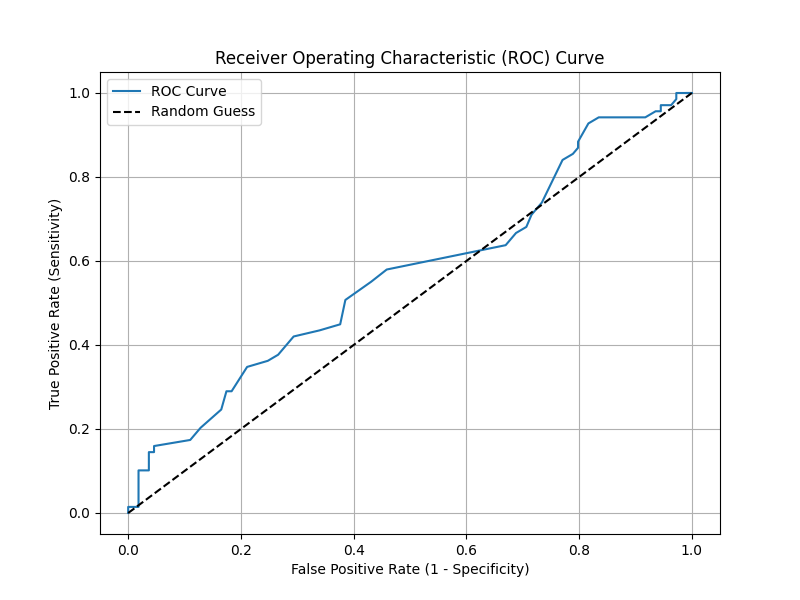
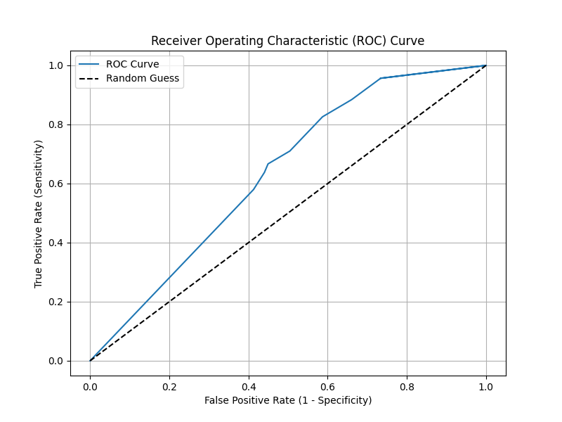
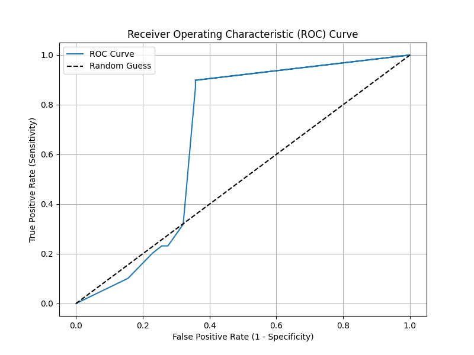
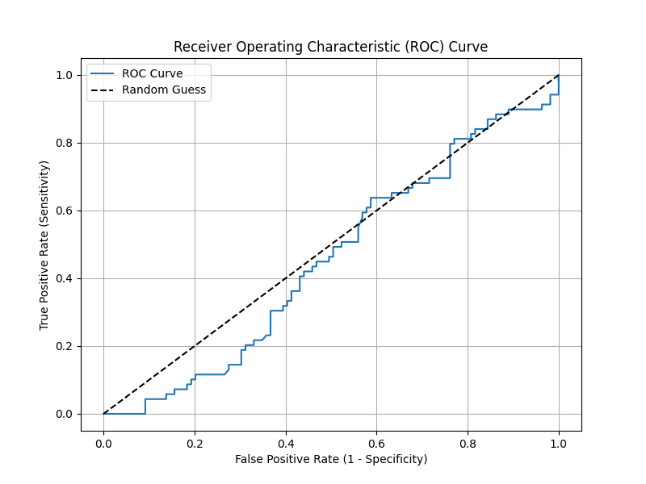
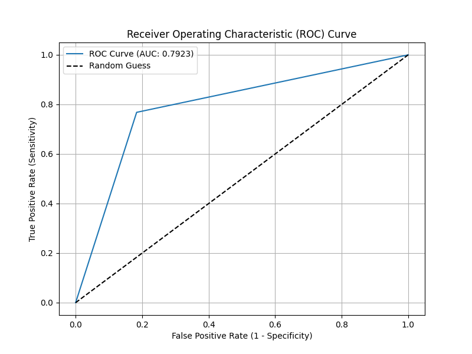
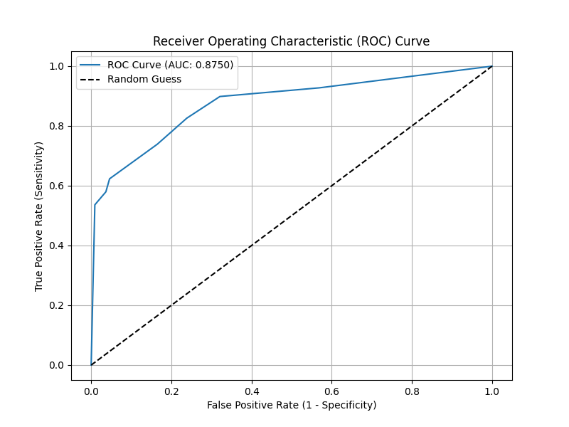
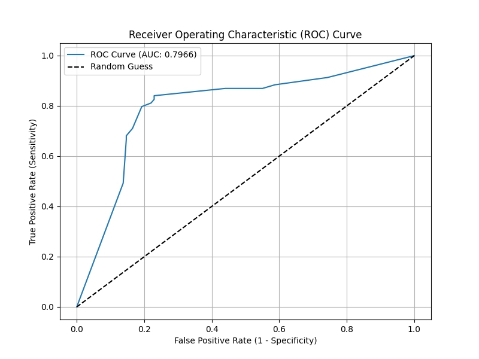
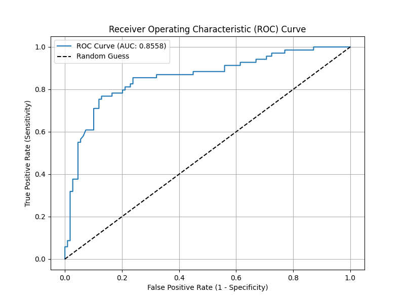

# 고전적 ML 성능 평가

## 이론과 구현, 분석

---

# 1. Introduction(소개)

이 프로젝트는 지금까지 구현한 모델들을 recall, precision, ROC curve 등의 성능 평가 지표를 이용해서 성능을 분석하는 것을 목표로 한다.

## 1.1 Motivation(동기)

### Project Objectives

- Accuracy을 가지고 모델의 신뢰성을 판단하는 게 합당한가에 대한 의문
- 성능 평가 방법의 이론과 원리에 대한 학습
- 성능 평가 방법의 중요성

---

# 2. Theoretical Background(이론적 배경)

## 2.1 Confusion Matrix(혼동 행렬)

<table border="1" style="border-collapse: collapse; border: 1px solid gray;">
    <tr style="border: 1px solid gray;">
        <th rowspan="2" colspan="2">Confusion Matrix</th>
        <th colspan="2" style="text-align: center;"> 예측</th>
    </tr>
    <tr style="border: 1px solid gray">
        <th style="text-align: center;">Postive</th>
        <th style="text-align: center;">Negative</th>
    </tr>
    <tr style="border: 1px solid gray">
        <th rowspan="2" style="text-align: center;">실제</th>
        <th style="text-align: center;">Positive</th>
        <td style="text-align: center;">True Positive(정탐)</td>
        <td style="text-align: center;">False Negative(미탐)</td>
    </tr>
    <tr style="border: 1px solid gray">
        <th style="text-align: center;">Negative</th>
        <td style="text-align: center;">False Positive(오탐)</td>
        <td style="text-align: center;">True Negative(정탐)</td>
    </tr>
</table>

모델 성능을 평가하기 위해서 예측 값과 실제 값과 비교해서 행렬로 시각화한 자료다.

- True Positive: 실제 True인 정답을 True라고 예측
- False Negative: 실제 True인 정답을 False라고 예측
- False Positive: 실제 False인 정답을 True라고 예측 
- True Positive: 실제 False인 정답을 False라고 예측

## 2.3 Accuracy(정확도)

$$ Accuracy = \frac{True \space Positive + True \space Negative}{True \space  Positive + False \space Negative + False Positive + True Negative} $$

- 예측 값이 얼마나 정확한가를 나타내는 지표이다.
- 특정 문제에서는 Positive case를 Negative로 잘못 판단하거나, Negative case를 Positive로 예측하는 문제가 소수가 있더라도 심각한 문제를 야기할 수 있지만, Accuracy는 이를 고려하고 있지 않기 때문에 유용한 지표라고 할 수 없다.

## 2.3 Recall(재현율)

$$ Recall  = \frac{True \space Positive}{True \space  Positive + False \space Negative} $$

- 실제 값이 True일 때 True를 맞출 확률을 의미한다.
- Recall이 높으면 모델이 Positive를 Negative로 판단한 것이 아니라 실제 값인 Positive case를 잘 찾은 것을 의미하고, 낮으면 Positive case를 잘 못 찾은 거다.
- Precision과 트레이드 오프 관계를 가진다. Recall을 높이기 위해 더 많은 데이터를 Positive로 예측하게 되면, 실제 Negative까지 Positive로 잘못 예측하는 경우가 증가하여 Precision이 낮아진다. 

## 2.4 Precision(정밀도)

$$ Precision  = \frac{True \space Positive}{True \space  Positive + False \space Positive} $$

- Positive로 예측했을 때 얼마나 정확한 가를 나타내는 지표이다.
- Precision이 높으면 Positive로 예측한 것은 대부분 맞췄다는 것을 의미한다.
- Precision이 낮으면 Negative case를 Positive로 예측한것이고 이때는 노이즈가 있음을 의미한다.
- Recall과 트레이드 오프 관계를 가진다. Precision을 높이기 위해 Positive로 예측하는 기준을 엄격하게 하면, 실제 Positive를 Negative로 잘못 예측하게 되는 경우가 증가하여 Recall이 낮아진다.

## 2.5 F1 score

$$ F1 score  = 2 * \frac{Precision * Recall }{Precision + Recall} $$

- Recall와 Precision은 트레이드 오프 관계를 가지기 때문에 두 지표의 균형을 이루는 정도를 나타내는 지표로 사용한다. 값이 놀을 수록 두 지표가 모두 높은 상태임을 의미한다.
- 조화평균을 사용한 이유는 하나라도 낮으면 전체 점수를 크게 낮춰 불균한 모델에게 페널티를 주기 위함이다.

## 2.6 ROC curve

- threshold의 변화에 따라 FPR과 TPR의 관계를 시각환한 그래프이다.

## 2.7 AUC

ROC curve 그래프의 하단 면적을 나타낸다. 1에 가까울 수록 모델의 판벽력이 뛰어나다가고 할 수 있다.

---

# 3. Implementation(구현)

- precision, recall, F1-score의 경우는 모델의 예측값과 정답을 매개변수로 하여 `BinaryClassifierPerformance`에서 혼동행렬을 생성하고 이에 따라 각 성능 지표를 반환하도록 구현한다.

- ROC curve의 경우에는 `ROCCurveDrawer`를 통해서 threshold 변화에 따른 TRP, FPR을 계산하고 이것을 그래프로 그리도록 구현한다.

---

# 4. Experimental Setup(실험 준비)

## 4.1 Datset

Titanic DataSet
- size: 891 x 12

## 4.2 유의 사항

Titanic의 경우 테스트 데이터에 정답 데이터가 없기 때문에 성능 평가와 모델 튜닝을 위해 사용하는 검증 데이터를 대신해서 성능 평가를 실시한다. 그래서 최종 성능라고 볼 수는 없다.

---

# 5. Process and Analysis of Failure(실패 과정 및 분석)

# 5.1 예상과의 차이
|           | Decision Tree | Random Forest | Batch Logistic Regression |  KNN   |
| :-------: | :-----------: | :-----------: | :-----------------------: | :----: |
| Accuracy  |    0.8358     |    0.8089     |          0.7977           | 0.8324 |
| Precision |    0.8392     |    0.8181     |          0.72602          | 0.8437 |
|  Recall   |    0.6811     |    0.6521     |          0.7681           | 0.7297 |
| F1 score  |    0.7520     |    0.7258     |          0.7464           | 0.7826 |

- 이전 프로젝트에서는 Accuracy만 보고 약 80% 이상이어서 모델이 정확하다고 판단해왔다. 
- 모델의 성능 지표에 Precision, Recall, F1 Score를 추가하여 판단하였을 때도 Random Forest가 Decision Tree보다 성능이 안 좋다는 것 말고는 이상한 점은 없었다.
- 성능이 안 좋은 이유 중 하나는 데이터의 수가 적어서거나 특정 threshold에서 Random Forest가 Decision Tree보다 성능이 잘 나오다고 추측할 수 있다. 그래서 ROC curve로 성능을 평가했다.

    
Logistic Regression

    

    
KNN

    

    
Decision Tree

    

    
Random Forest

    

ROC curve를 보고 모델이 특정 threshold에서 성능이 안 좋은 것이 아니라 랜덤으로 예측한 결과보다 일부분이 좋거나 오히려 더 안 좋다는 것을 알 수 있었다.

## 5.2 원인 분석 및 해결

- 우선, 구현 문제를 원인으로 판단하고 다음 과정을 실행했다.

- 첫 번째로 ROC curve를 계산하는 메서드에 문제를 확인했다. threshold 들과 각 모델의 출력에 대한 결과를 계산하는 부분에서 부호를 >에서 >=로 변경했다. Logistic Regression의 ROC curve는 랜덤 예측보다 높거나 같은 수준을 가지게 되었지만 나머지 모델의 경우에는 변화가 없었다.

- 두 번째로 각 모델 내부의 로직이 잘못되었다고 판단하였다.
  - KNN의 경우에는 두 가지 원인이 있었다.
    - 첫 번째, predict_proba에서 이진분류의 경우 0, 1의 각각의 확률이 있어야 했지만, 한 쪽의 클래스의 확률이 1인 경우에 나머지 클래스의 확률을 0으로 처리하는 기능이 없었다.
    - 두 번째, 이웃의 수를 결정하는 K의 경우 짝수인 경우에는 클래스 비율이 동등해져서 클래스를 분류 못하는 문제가 발생할 수 있었는데 이에 대한 처리를 하지 않았다.
    - 위의 문제를 해결했을 때 KNN은 초반 threshold에서 성능이 안 좋았던 문제가 해결되었다.

  - Decision Tree, Random Forest의 경우에도 두 가지 원인이 있었다.
    - gini와 gini split를 계산하는 함수에서 부호를 >=로 처리해야 되는 것을 >로 처리하고 있어서 계산에 문제가 발생했었다.
    - 모델의 결과에 대한 클래스의 확률을 계산하는 함수에서 각 노드의 확률을 계산하는 부분에서 y(정답)으로 확률을 계산해야 헀지만 구현 오류로 인해서 x(데이터)로 계산해서 분산을 확률로 처리했던 것이 문제였다.
    - 트리에서 자식으로 분할할 때 best split한 feature의 데이터를 가지도록 구현이 되어 있어 확률이 제대로 계산되지 않는 문제가 있었음을 파악했다.
    - 위의 문제를 해결했을 때 두 모델 모두 원하는데로 랜덤 에측보다 좋은 curve를 가지게 되었다.

---

# 6. Experimental Results(실험 결과)

## 6.1 ROC Curve

### Lostic Regression

### KNN

### Decision Tree

### Random Forest

## 6.2 성능 평가

|           | Decision Tree | Random Forest | Batch Logistic Regression |  KNN   |
| :-------: | :-----------: | :-----------: | :-----------------------: | :----: |
| Accuracy  |    0.8258     |     0.808     |          0.7977           | 0.7977 |
| Precision |    0.8392     |    0.8181     |          0.72602          | 0.7391 |
|  Recall   |    0.6811     |    0.6521     |          0.7681           | 0.7391 |
| F1 score  |    0.7520     |    0.7258     |          0.7465           | 0.7391 |
|    AUC    |    0.7259     |    0.8554     |          0.7923           | 0.8750 |

---

## 6.3 해석

전체적인 균형 (F1 기준) → Decision Tree
확률 기반 분류 성능 (AUC) → KNN / Random Forest
Precision 중심 → Decision Tree
Recall 중심 → Logistic Regression

### 모델 별 해석

1. Decision Tree
   - Accuracy가 가장 높음
   - Precision가 가장 높음
   - F1 score 가장 높음
   - AUC는 가장 낮음
   - ✏️ Precision이 가장 높기 때문에 Positive 에측한 것을 정확하게 예측하는 것을 제일 잘함.

2. Random Forest
   - Precision 2등
   - Recall이 가장 낮음 
   - F1 score가 가장 낮음
   - AUC가 좋음
   - ✏️ 특정 다양항 threshold에서 노이즈에 민감하지 않은 robust한 모델로 전체적인 성능이 좋음을 알 수 있다.

3. Batch Logistic Regression
   - Precision이 가장 낮음
   - Recall이 가장 높음 
   - ✏️ Positive를 놓치면 안되는 문제에 대해서 성능이 좋다.

4. KNN
   - AUC가 가장 높음
   - F1score 보통
   - Recall, Precision 보통
   - ✏️ AUC가 높기 때문에 전체적인 성능이 좋다. 하지만 Recall, Precision이 보통인 것은 threhold가 고정되면 성능이 안 좋음을 알 수 있다.

# 7. Future Work(향후 연구)

- 성능 지표을 활용해서 해석 능력 

---

# 8. Conclusion

본 프로젝트에서 다양한 성능 지표의 이론을 정리하고, 다양한 성능 지표를 활용해서 성능을 평가해봤다.

이를 통해
  - AUC 점수가 높은 모델의 경우에 대해서는 threshold를 튜닝하면 성능이 좋아질 가능성이 있다.
  - ROC curve를 통해서 모델의 문제를 파악하고 수정할 수 있었다. 이러한 과정에서 다양한 성능 지표의 중요성을 알 수 있었다.

을 수행하였다.
